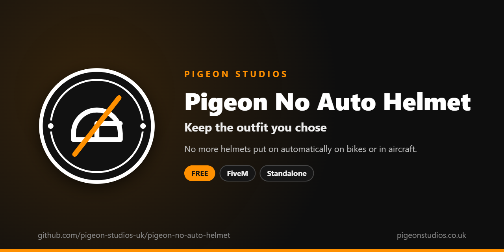

<div align="center">
  

  <h1>Pigeon No Auto Helmet</h1>

  <p><strong>Stops GTA putting a helmet on players automatically when they get on a bike or into an aircraft.</strong></p>

  <p>
    <a href="https://github.com/pigeon-studios-uk/pigeon-no-auto-helmet/releases/latest"></a>
    <a href="LICENSE.md"></a>
    <a href="https://discord.gg/2NFVWEUmDF"></a>
    
  </p>

  <p>
    <a href="https://github.com/pigeon-studios-uk/pigeon-no-auto-helmet/releases/latest"><strong>Download</strong></a> ·
    <a href="#installation">Install</a> ·
    <a href="#configuration">Configure</a> ·
    <a href="CHANGELOG.md">Changelog</a> ·
    <a href="https://discord.gg/2NFVWEUmDF">Support</a>
  </p>
</div>

---

## Contents

- [Overview](#overview)
- [Features](#features)
- [Requirements](#requirements)
- [Installation](#installation)
- [Updating](#updating)
- [Configuration](#configuration)
- [How it works](#how-it-works)
- [Update checker](#update-checker)
- [Performance](#performance)
- [Security](#security)
- [Troubleshooting](#troubleshooting)
- [FAQ](#faq)
- [Support](#support)
- [Contributing](#contributing)
- [Licence](#licence)
- [Credits](#credits)

## Overview

Pigeon No Auto Helmet is a free resource by [Pigeon Studios](https://pigeonstudios.co.uk) that stops GTA putting a helmet on players' characters by itself. Normally, getting on a motorbike puts a random motorbike helmet on, and getting into a helicopter or plane puts on a flight helmet. On roleplay servers, where players choose their outfits carefully, that undoes their look every time they ride.

With this resource, players keep exactly what they're wearing. Anyone who wants a helmet can still wear one from their clothing.

## Features

- **No automatic bike helmets** on motorbikes, bicycles and quads.
- **No automatic flight helmets** in helicopters and planes. Can be turned off if you want to keep these.
- **Nothing to take off.** The helmet is never put on, so there's no flicker or removal animation.
- **Players' own helmets stay.** Helmets chosen from clothing, including clothing packs, are left alone.
- **Survives respawns and model changes.** Applied again straight away when a player respawns, and every second in case their character changes some other way.
- **Undoes itself.** Stopping the resource gives GTA its helmets back.
- **Standalone.** No framework or other resources needed.

## Requirements

| Requirement | Version | Notes |
|---|---|---|
| FXServer | A [recommended artifact](https://runtime.fivem.net/artifacts/) | |

**Frameworks:** none needed. It works the same on standalone servers, ESX Legacy, QBCore, Qbox and ox_core.

## Installation

1. **Download** `pigeon-no-auto-helmet.zip` from the [latest release](https://github.com/pigeon-studios-uk/pigeon-no-auto-helmet/releases/latest). Don't use the green **Code** button; release zips are the tested builds.
2. **Extract** it into your server's `resources` folder. The folder must be called `pigeon-no-auto-helmet`.
3. **Start it** by adding this to `server.cfg`:

   ```cfg
   ensure pigeon-no-auto-helmet
   ```

4. **Configure** it in `configuration/config.lua` if you want to change anything. The defaults work as they are.
5. **Restart** your server. The console shows one line from the update checker:

   ```text
   [Pigeon Studios] Pigeon No Auto Helmet v1.0.0 is up to date.
   ```

## Updating

1. Read the [changelog](CHANGELOG.md) for every version between yours and the latest, especially any **Upgrade notes**.
2. Back up your `configuration/` folder.
3. Replace the `pigeon-no-auto-helmet` folder with the new release.
4. Copy your changed settings into the new `configuration/config.lua`. Don't copy the old file over the new one; new versions can add settings.
5. Restart the resource.

## Configuration

All settings are in `configuration/config.lua`, each explained by a comment next to it.

| Setting | Default | What it does |
|---|---|---|
| `Config.Bikes` | `true` | Stop GTA putting a helmet on players on motorbikes, bicycles and quads |
| `Config.Aircraft` | `true` | Stop GTA putting a flight helmet on players in helicopters and planes |
| `Config.ReapplySeconds` | `1.0` | How often the settings are applied again, for characters that change without a respawn |

## How it works

GTA decides whether to give a character an automatic helmet using two of its per-character settings, called ped config flags: `DisableAutoEquipHelmetsInBikes` (380) and `DisableAutoEquipHelmetsInAircraft` (381). The resource turns those on for the player's own character, so GTA never puts the helmet on in the first place.

A character's flags reset when the character is replaced, which happens when a player respawns, changes model or has their appearance reset by some clothing resources. The flags are set again straight away on respawn, and every `Config.ReapplySeconds` for anything else.

When the resource stops, both flags are turned off again.

## Update checker

When it starts, Pigeon No Auto Helmet checks our public [version registry](https://github.com/pigeon-studios-uk/pigeon-versions) once and prints one line in the server console saying whether it's up to date. If there's an update, it shows what's new and where to get it. The check is a single request to GitHub and sends nothing about your server or players.

Control it for every Pigeon Studios resource at once in `server.cfg`:

```cfg
set pigeon_update_check "on"      # default: one line per resource
set pigeon_update_check "quiet"   # only when there's an update or a problem
set pigeon_update_check "off"     # never check
```

## Performance

It sets two flags once a second and does nothing else. Nothing runs every frame, and nothing runs on the server apart from the update check at start-up.

## Security

- It runs only in each player's own game and only changes that player's own character. Other players and NPCs are never touched.
- It has no commands, exports or network events, so there is nothing other players, other resources or the server can send it.
- The only network request is the update check at start-up, from the server to GitHub. It sends nothing about your server or players.

Found a problem? Please don't open a public issue. Use the **Report a vulnerability** button in this repository's **Security** tab, or follow our [Security Policy](https://github.com/pigeon-studios-uk/.github/blob/main/SECURITY.md).

## Troubleshooting

**Players still get a helmet on bikes.**
Check the resource is started and there are no errors in the F8 console. Some resources put helmets on players themselves, for example a vehicle or job resource; this resource only stops GTA's automatic helmet.

**A player's own helmet disappeared.**
This resource never takes a helmet off. Check your clothing or vehicle resources.

**The console says "isn't in the version registry" or "couldn't check for updates".**
Your server couldn't reach GitHub, or the check is blocked by a firewall. The resource works normally either way. Turn the check off with `set pigeon_update_check "off"`.

## FAQ

**Is it really free?**
Yes. Use it on as many servers as you like, including ones that take donations. You just can't reupload, resell or bundle it. See [Licence](#licence).

**Does it affect NPCs?**
No. Only players' own characters are changed.

**Can players still wear helmets?**
Yes. Any helmet from their clothing works as normal.

**Does it change how much protection a helmet gives?**
No. For that, see [Pigeon No Helmet Armour](https://github.com/pigeon-studios-uk/pigeon-no-helmet-armour).

## Support

Read [Troubleshooting](#troubleshooting) first, then ask in the support channels of our [Discord](https://discord.gg/2NFVWEUmDF). Please include your Pigeon No Auto Helmet version, FXServer artifact and any errors from the console. See [Getting help](https://github.com/pigeon-studios-uk/.github/blob/main/SUPPORT.md).

Found a bug? Open a [bug report](https://github.com/pigeon-studios-uk/pigeon-no-auto-helmet/issues/new/choose).

## Contributing

Fixes and improvements are welcome. Please read the [contributing guide](https://github.com/pigeon-studios-uk/.github/blob/main/CONTRIBUTING.md) first, and open a feature request before working on anything big.

## Licence

Pigeon No Auto Helmet is free to use under the **[Pigeon Studios Free Licence](LICENSE.md)**.

- ✅ Use it on any number of servers, including monetised ones
- ✅ Change it for your own servers
- ✅ Show it in videos and streams
- ❌ Don't reupload, share or mirror the files; link to this repository instead
- ❌ Don't sell it, bundle it in packs, or put it behind escrow
- ❌ Don't remove the credits

This summary isn't the licence; [LICENSE.md](LICENSE.md) is. Third-party notices are in [NOTICE.md](NOTICE.md).

## Credits

Made by [Pigeon Studios](https://pigeonstudios.co.uk).

<sub>Not affiliated with or endorsed by Rockstar Games, Take-Two Interactive or Cfx.re.</sub>
